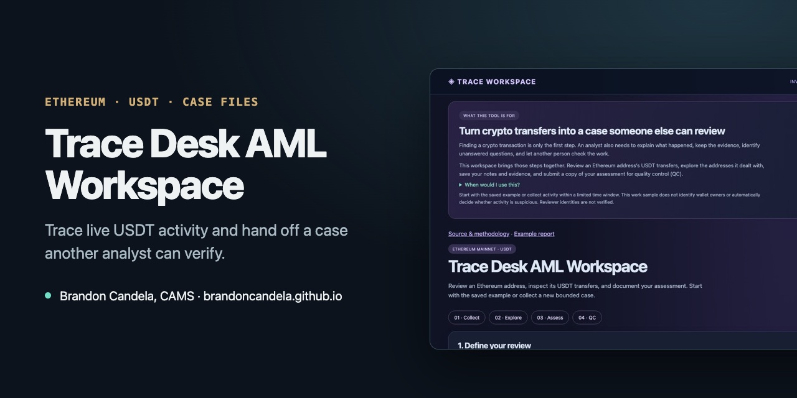

# Trace Desk AML Workspace



**[▶ Open the live demo](https://brandoncandela.github.io/trace-desk-aml-workspace/)** · [Portfolio](https://brandoncandela.github.io/) · [LinkedIn](https://www.linkedin.com/in/brandon-candela/) · Built by Brandon Candela, CAMS, PMP

> **What this shows:** a crypto investigation from start to QC: pull real Ethereum USDT transfers, follow the money one wallet at a time, write up what you found and hand the case to a reviewer.

## What it does

You give it an Ethereum address and a time window of up to two hours. The workspace pulls that address's USDT transfers straight from a public Ethereum node, draws who sent money to whom, and lets you expand to up to five wallets. As you go, you pin the transactions that matter, mark each warning sign as reviewed and write your conclusion. The case can be saved, reopened and sent to a reviewer, who can return it with findings.

There's also a saved example case that works offline, so the demo never depends on a node being up.

## Try it

1. Open the [live demo](https://brandoncandela.github.io/trace-desk-aml-workspace/) and start with the saved example.
2. Click a wallet in the graph to filter its transfers, and open a transaction for its full details.
3. Look at the warning signs: matching amounts moving on in sequence, many counterparties, very small incoming transfers, and transfers larger than the activity you expected.
4. Pin the evidence that supports your view, fill in the checklist and write your conclusion.
5. Submit for QC, then switch roles and review it: attach findings to a transaction, then return it or sign it off.

To run a live query, enter an address and a window that ended at least 20 minutes ago. The query goes from your browser to `rpc.mevblocker.io`; nothing is stored on a server.

## Design choices

- **Small, bounded scope.** A query covers at most 700 blocks, 1,000 transfers and five wallets. Every alert stays explainable, and an over-budget query never replaces the case you're looking at.
- **Exact amounts.** USDT amounts are decoded from the raw logs and kept as whole-number base units, never floating point.
- **Warning signs, not scores.** Each sign links to the transfers behind it. Matching amounts in sequence are a lead; they don't prove it's the same money.
- **Empty means empty.** If a window has no transfers, the case says so. It doesn't treat that as the wallet being clean.
- **Portable case files.** A saved case is a JSON file with a SHA-256 checksum. Opening it checks the checksum, amounts and references. The checksum catches accidental changes; it can't prove who wrote the file.
- **QC rounds.** Each submission is frozen as a snapshot. If the analyst changes the evidence afterwards, the old review no longer counts for it.

## The saved example

The example comes from 80 Ethereum blocks (25,929,879 to 25,929,958) containing 7,640 USDT transfers. The tool picked a wallet with 6 to 12 trading partners and followed it two hops out, giving 15 wallets and 15 transfers. [CASE_REPORT.md](CASE_REPORT.md) is the written analysis, including a two-step transfer sequence worth a closer look. It is a triage exercise on public data, not an accusation against anyone.

All raw node responses are saved in `data/raw/`, and `data/manifest.json` records their checksums, so the example rebuilds identically offline.

## Run it locally

Python 3.10 or later, no packages to install.

```sh
python3 app.py                       # then open http://127.0.0.1:8000
python3 -m unittest discover -s tests -v
python3 verify.py                    # re-checks the saved evidence
node --test tests/*.mjs              # browser logic, case files and QC
python3 build_demo.py                # rebuilds the static site in dist/
```

On a Mac you can also double-click `Launch.command`. To collect a fresh example from a public node:

```sh
ETH_RPC_URL=https://rpc.mevblocker.io python3 collect.py --blocks 80 --output fresh-data
```

| File | What it does |
| --- | --- |
| `collect.py` | Pulls USDT transfer logs and block headers from an Ethereum node |
| `investigator.py` | Decodes transfers and builds the bounded wallet graph |
| `verify.py` | Re-checks saved evidence against the manifest |
| `static/live.mjs` | Runs live queries from the browser |
| `static/core.mjs` | Decoding, de-duplication, warning signs and exports |
| `static/qc.mjs`, `static/casefile.mjs` | QC rounds and portable case files |
| `tests/` | Python and Node tests for decoding, limits, case files and QC |

## Limits

- A wallet address isn't a person, and nothing here labels a wallet as belonging to an exchange or individual.
- The window shows a slice of activity, not the wallet's full history or balance.
- Data comes from one public node. The checksums catch local changes but don't independently prove the node was right.
- Notes stay in the browser tab until you save a case file.

Built with AI coding tools. MIT license; the saved node data is included so results can be reproduced.
